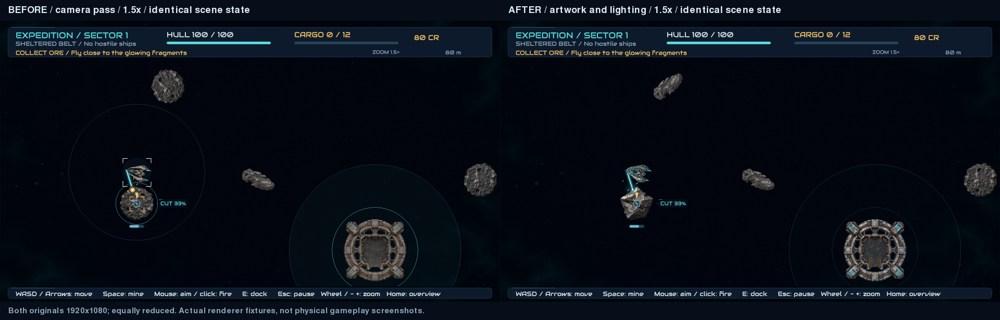
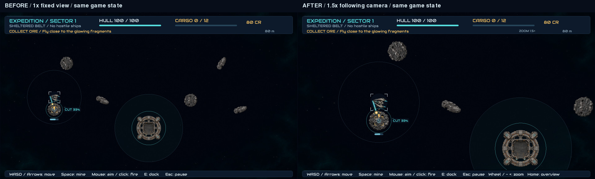
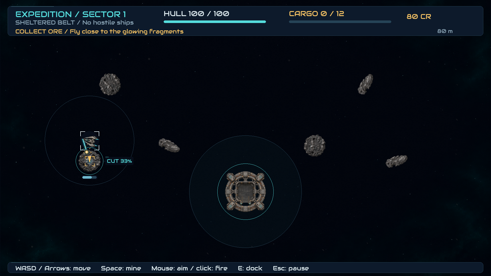

# Dust to Dominion

A small offline asteroid-mining campaign built locally on scorbo2's
spec-first pygame-ce game. Mine and sell ore, upgrade your ship, fight rival
ships, hire two crew members and build a three-ship operation. Win with both
crew members, three ships and 1,200 credits in the bank; you can keep playing.

This local continuation includes a complete playable ruleset, textured artwork
and a player-following camera. The new gameplay sound pass builds on reviewed
artwork revision `844ad1d`. Serge has confirmed the core native controls and
principal sound cues; remaining listening checks, balance and **visual acceptance
remain open**. The
[campaign specification](docs/19-complete-small-game.md) and
[team handoff](docs/reviews/TEAM-HANDOFF.md) retain the rules and implementation history.

## Native-resolution fullscreen

Local product **`696c3bc`** passes **2,061 automated tests**.
Fullscreen now draws the campaign directly at the display-fitting resolution.
On Serge’s 3440×1440 monitor, the game area is **2560×1440 at 1:1 pixels**,
centered with side bars. It previously enlarged a 1920×1080 world image.
A 3840×2160 drawing path is also implemented; physical 4K hardware remains
unverified. Logical geometry, camera zoom, game rules and saves are unchanged.
The fullscreen transition also refreshes stationary mouse aiming to account for
SDL’s changed content position.

[Native-resolution report and before/after images](docs/reviews/2026-11-20-native-resolution/review.md)
separate actual native-display measurements, offscreen rendering and pending
human review. Save at the station, close the old game, reopen **Open Dust to
Dominion.command**, choose **Continue**, and use **Control+Command+F**.

## Gameplay sound and controls

Local product **`e46970f`**: **2,010 automated tests passed**, including independent
audio lifecycle/device checks. Serge subsequently confirmed movement/engine,
mining/pickup, docking/selling, zoom aiming, pause/resume, rival combat and
save → title → Continue. See the [human-play addendum](docs/reviews/2026-11-20-gameplay-audio/manual-results.md)
for exact evidence and unperformed checks.

Eight original synthesized sounds cover thrust, mining contact, ore pickup,
weapons, impacts, destruction, docking and selling. Loops follow valid activity;
pausing, focus loss, docking and leaving the screen clear campaign sounds.
Game SFX mute and volume apply, including zero-volume mute without stale tails.
When audio-device initialization fails, the game logs a warning and remains
playable silently; restart with a working device to restore audio.

See the [milestone report](docs/reviews/2026-11-20-gameplay-audio/review.md),
[independent QA](docs/reviews/2026-11-20-gameplay-audio/independent-review.md) and
[Serge's short manual checklist](docs/reviews/2026-11-20-gameplay-audio/MANUAL-CHECKLIST.md).
Original generator, measured levels and MIT provenance are retained in
[the audio sources](assets/source/audio/README.md). These are synthesized effects,
with human loudness/timbre acceptance still pending.

Reopen **Open Dust to Dominion.command → Continue → Launch / Sector 1**.
Use Options to enable/adjust **game sound effects**. Space mines rocks; weapons
hit rival ships outside the shield. Sector 1 has no rivals. Existing saves,
artwork, camera, hitboxes, combat and economy are preserved. The audio baseline
used a 1920×1080 world canvas; the new rendering milestone is documented in the
[native-resolution review](docs/reviews/2026-11-20-native-resolution/review.md).

## Artwork and lighting

**1,958 tests passed** for the prior artwork revision `844ad1d`. See its
[review](docs/reviews/2026-11-20-art-lighting/review.md) for recorded play, the known
dummy-display warning and performance evidence.

Six new reusable assets add angular iron, broken gold and crystal rock forms,
clearer ship materials and a brighter station. The player uses a hull-shaped
contour instead of a dark circular backing. Mining contact follows the visible
rock surface; bounded chips, thruster light and impact bursts respond to play.
Quieter range rings and targeting corners preserve essential navigation cues.
The camera, hitboxes, rules, economy and saves are unchanged.



Both originals are 1920×1080 actual renderer fixtures at the same 1.5× zoom and
model state, equally reduced here. [Combat comparison](docs/reviews/2026-11-20-art-lighting/combat-before-after.png)
and [reference comparisons, recordings and QA](docs/reviews/2026-11-20-art-lighting/review.md)
separate evidence from concept art. Lighting remains a 2D approximation; these
images do not establish a match to the cinematic reference.

## Camera and framing (prior pass)

**1,928 tests pass**, including an earned mining/sale trip and rival defeat.
Native graphics passed at 3440×1440 desktop fullscreen with a 1080p backbuffer.
One known dummy-display test warning is documented in the report.

Flight starts at **1.5× zoom**. Use the mouse wheel or **− / +** (`=` also works)
to select **1×, 1.5× or 2×**; **Home** returns to overview. The camera follows your
ship and stops at the arena edges. Offscreen station/rival arrows show direction
and world distance. Aiming follows the pointer correctly while the camera moves;
HUD text and station/fleet menus stay in screen space. Zoom is session-only and
retained between trips; existing saves and gameplay geometry are unchanged.



Both source images are 1920×1080 actual renderer captures of the same synthetic
model state, shown at equal size. See [earned mining](docs/reviews/2026-11-20-camera/final/trip-mining.png)
and [earned combat](docs/reviews/2026-11-20-camera/final/combat-firing.png) for
input-driven gameplay. These historical camera captures use a **1920×1080**
world canvas. Their offscreen 3840×2160 output scales that world and must not be
confused with the later direct native-resolution rendering evidence.

## Earlier realistic visual upgrade

[Actual versus reference: four side-by-side image sheets and camera evaluation](docs/reviews/2026-11-20-reference-comparison/review.md). **Visual acceptance remains open for Serge’s review.**

The initial upgrade introduced 13 standalone artwork assets: four ships, Kepler Station,
four mineral asteroid forms, two crew portraits, a docking bay and a starfield.
Mining beams, contact sparks, exhaust, projectile trails and hit flashes respond
to play. A broad docking panorama and larger fleet previews show the artwork
alongside live values. Labels and health bars avoid ships and each other; red rims and brackets
keep rivals visible over ore. A faint shield and sparse distant debris add depth.
The gameplay rules and version-one saves are unchanged.



This is an actual rendered game scene from a synthetic stress fixture, separate
from the earned mining-trip captures. The supplied
[visual target](docs/concepts/realistic-visual-target-2026-11-20.png) is concept art;
the game preserves its existing small-scale geometry and does not yet match the
reference's cinematic detail. The
[implementation prompt](docs/DustToDominion_Realistic_Visuals_Team_Prompt.md),
[plan](docs/21-realistic-visual-upgrade.md) and
[asset sources and prompts](assets/source/realistic/README.md) are retained.

Validation: product `957e96b`, final test refinement `a61e8d6`:

- **1,860 tests passed**, including earned progression, combat, defeat and saves.
- The repeated automated trip launched, mined, collected, docked and sold three
  iron units: **80 → 110 credits**. Physical input acceptance remains separate.
- **32 updated English/German captures** at 720p, 1080p, 1440p and offscreen 4K;
  zero detected label/bar/ship overlaps. Independent QA and art review passed.
- Native windowed/fullscreen/windowed graphics checks passed on the main monitor.
  Fullscreen uses its **3440×1440** desktop resolution and a **1920×1080 backbuffer**.
  Offscreen 3840×2160 output uses output-size text with an upscaled 1080p world;
  physical 4K fullscreen and native 4K artwork are unverified.
- One test warning: `no fast renderer available` in the dummy-display save-failure
  test. See the report for native probe warnings and timing details.

Updated screenshots: [mining](docs/reviews/2026-11-20-realistic-polish/final/en-us-1920-mining.png),
[combat](docs/reviews/2026-11-20-realistic-polish/final/en-us-1920-combat.png),
[station](docs/reviews/2026-11-20-realistic-polish/final/en-us-1920-station.png),
[fleet](docs/reviews/2026-11-20-realistic-polish/final/en-us-1920-fleet.png).

Remaining at that earlier review: physical mouse/keyboard play, audio, human judgment of balance and art,
and other displays/platforms. Distant framing, baked lighting and prominent HUD
panels remain differences from the reference. Detailed evidence and limitations:
[validation report](docs/reviews/2026-11-20-realistic-polish.md) and
[independent review](docs/reviews/2026-11-20-realistic-polish/independent-review.md).

Work stays local. Nothing is pushed to the upstream repository.
Earlier [vector-art screenshots](docs/reviews/2026-11-20-feedback.md) and the
[team handoff](docs/reviews/TEAM-HANDOFF.md) preserve the implementation history.

## Play

On this Mac, double-click **Open Dust to Dominion.command** on the Desktop
(or the original in this project folder), then choose
**New Game → Launch / Sector 1**. The launcher uses the project's existing
`.venv`; setup instructions below apply on a new installation.

- **WASD / arrows:** move. **Space:** mine nearby asteroids; fly over ore to collect it.
- **Mouse / left click:** aim / fire. **E:** dock inside the station beacon.
- **Wheel / − / +:** zoom; **Home:** overview. Default is 1.5×.
- **Esc:** pause during flight. Losing window focus also pauses.
- At the station, sell cargo, repair, buy upgrades, hire crew and buy support ships.
- Sector 1 has no enemies. Sectors 2 and 3 unlock after 300 and 1,000 credits in sales.
- Defeat or confirmed abandonment loses cargo and returns you with half hull for free.

Your ship has a thin cyan hull contour in the flight view; rivals use red accents. At the
station, choose **View fleet** to inspect all three vessel silhouettes, ownership
and bonuses. Support ships provide passive ore-sale bonuses and do not fly
alongside you. The station shield locks your weapons and absorbs all shots;
leave the blue safe area before fighting rivals.

Progress saves at the station, including after purchases and returning from
an expedition. **Continue** resumes the last station checkpoint; quitting in
flight loses that expedition's progress. Save failures are shown on screen.
New Game confirms replacement and preserves the previous save in a backup file.
Settings live in `~/.DustToDominion/game.json`; progress lives separately in
`~/.DustToDominion/campaign.json` by default.

## Setup instructions

Requires Python 3.12.

```bash
python3.12 -m venv .venv
source .venv/bin/activate
pip install -r requirements.txt
```

## Testing instructions

The test suite is hermetic (spec 00): it runs under pygame's dummy video and
audio drivers and redirects all persistence to temp directories, so no
display, sound card, or write access to `~/.DustToDominion` is needed.

```bash
source .venv/bin/activate
python -m pytest
```

## Running the game

```bash
source .venv/bin/activate
python main.py
```

The game opens at 1920x1080, or 1280x720 on smaller displays, unless fullscreen is saved in your settings.
`F11` toggles windowed/fullscreen. Closing the window quits; `Esc` quits from
the title screen and pauses during an expedition.

The main configuration file is `game.json`, stored inside the persistence
directory (default: `~/.DustToDominion/`). The file is optional - if it is
missing or invalid, the game logs a warning and proceeds with default values.

Environment variables:

- `DUST_TO_DOMINION_HOME` - full path to the persistence directory
  (replaces `~/.DustToDominion`)
- `DUST_TO_DOMINION_CONFIG` - full path to the `game.json` file (takes
  precedence over the persistence-directory default)

### Window mode (spec 02)

```json
{
  "mainWindow": {
    "mode": "fullscreen",
    "display": 1
  }
}
```

| Key          | Required when `mainWindow` is present          | Description                                                        |
| ------------ | ---------------------------------------------- | ------------------------------------------------------------------ |
| `mode`       | always                                         | `windowed` (default) or `fullscreen`                               |
| `resolution` | optional legacy setting | accepted but ignored; fullscreen uses the monitor resolution |
| `display`    | never (optional)                               | numeric display index, defaults to the primary display (`0`)       |

Windowed mode prefers a fixed, non-resizable 1920x1080 window, falling back to 1280x720 on smaller displays. Fullscreen uses the current desktop mode with the largest exact 16:9 content surface that fits it. On a 3440×1440 desktop, game content renders at 2560×1440 with side bars; a 3840×2160 desktop uses 3840×2160. Graphics and text render directly at that content resolution. Unknown desktop dimensions retain a warned 1080p fallback. On macOS, Ctrl+Cmd+F also toggles fullscreen. Press `F11` at
runtime to toggle between windowed and fullscreen modes; switching to
fullscreen always uses the monitor's current desktop resolution. Successful switches
are written back to `game.json`.

## Known issues

1. On a Windows system, when playing in windowed mode (not fullscreen), clicking and dragging the
  main window's title bar to move the window will cause music to pause until the mouse is released.
  This is a GIL starvation issue caused by the mechanism we use to load and play audio resources.
  This is neither SDL's fault nor Pygame's fault. On Windows, our main thread is parked during a
  window drag operation, preventing our code from keeping the audio buffer full. Note that this
  seems to only be an issue on Windows.
