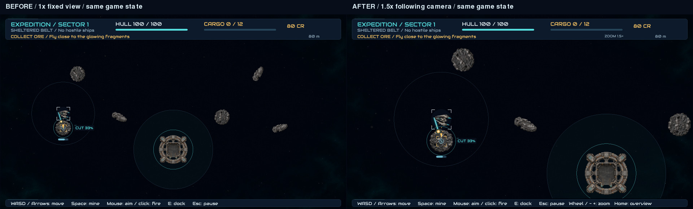
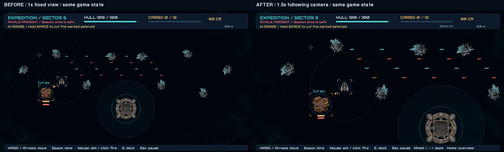

# Camera and framing — 2026-11-20

## 1. Result and acceptance boundary

The working flight camera follows the player at **1.5× by default**, with 1×
overview and 2× close view. World artwork, geometry, effects and anchors use one
forward transform; mouse aim uses its inverse after the existing SDL/UI mapping
exactly once. A stationary cursor is remapped on every simulation step. Released
quick clicks retain their click-time world target; held fire tracks the cursor.

Offscreen station and nearest-two rival indicators show direction and true world
distance, with an additional-threat count when needed. Fixed-size labels, menus
and HUD stay in screen space. Indicator placement avoids projected ship bounds.
Camera zoom changes neither the simulation nor saved progression.

**Human visual acceptance remains OPEN.** Automated event-driven play is separate
from physical keyboard/mouse play, audio and subjective difficulty/art acceptance.
Internal world rendering remains 1920×1080; native 4K world rendering is not part of
this pass. The [canonical plan](../../21-realistic-visual-upgrade.md) retains its
proposed status for those outstanding acceptance boundaries.

## 2. Matching before/after gameplay captures

Both originals in each pair are **1920×1080**. The comparison sheets reduce both
sides equally to 960×540 and add a heading; they are review layouts, not game
framebuffers. The actual renderer drew the exact same serialized campaign and
expedition states before/after; no actor was moved to make the after image look
better. These matched states are deliberately synthetic, including a rival over
ore and stress projectiles. The earned route below is separate.



[Before mining](baseline/mining.png) · [After mining 1.5×](final/en-us-1920-mining-z1.5.png) · [After mining 2×](final/en-us-1920-mining-z2.png)



[Before combat](baseline/combat.png) · [After combat 1.5×](final/en-us-1920-combat-z1.5.png) · [After combat 2×](final/en-us-1920-combat-z2.png)

The baseline report records revision `b268b1a` and the 36 original source hashes.
The final report records 38 current source hashes, including the two new modules.
Its Git revision is the pre-commit HEAD; source hashes identify the tested working
tree. See [baseline report](baseline/report.json) and [final report](final/report.json).

## 3. Earned play and independent checks

One continuous new campaign, isolated from the user's saves, was driven through
pygame events. No cargo, position, credits or unlocks were injected:

1. Launch Sector 1, fly to ore, mine, collect three iron, return to the station,
   dock and sell: **80→110 CR**. Checkpoint cargo and sale values were verified.
2. Complete two further mining sorties and buy cargo/laser upgrades, earning
   **330 lifetime sales** and Sector 2 access.
3. Fly outside the shield, aim/fire at an onscreen rival, defeat it and dock.
   **70 CR bounty banked, 190→260 CR**, then Continue verified the saved checkpoint.
   All 46 fired/held aim samples were inside the viewport.

Actual earned captures: [launch](final/trip-fresh.png),
[mining](final/trip-mining.png), [collected](final/trip-collected.png),
[docked](final/trip-docked.png), [sold](final/trip-sold.png),
[combat firing](final/combat-firing.png),
[rival defeated](final/combat-defeated-rival.png),
[station](final/menu-station.png), [fleet](final/menu-fleet.png).

- Full regression: **1,928 passed, one warning, 64.67s**.
  [Full log](full-suite.log); the final indicator regression also passed alone.
- Independent camera tests use separately derived projection/inverse arithmetic,
  covering all three zooms, 720p/1080p/1440p/offscreen 2160p, stationary-cursor
  movement, quick taps, simulated SDL logical fullscreen mapping, arena corners,
  model/RNG/save purity and session-only zoom retention.
- Final matrix: 48 matching mining/combat captures plus 8 navigation fixtures
  (EN/DE×four outputs), and 11 earned/menu originals. Zero detected framebuffer,
  button or world label/bar bounds/overlap warnings in those checks.
- Review reproduced and fixed a 2× station-chip overlap with a visible rival near
  the bottom edge. [Navigation example](final/en-us-1920-navigation-z2.png).
  Indicators now reserve projected hull/bracket bounds and draw after guidance.
- Core model, save/store, guidance rules, display implementation and dependencies
  are byte-for-byte unchanged from baseline `b268b1a`. All 38 final product source hashes match.

These checks do not prove every possible runtime composition is collision-free.
The independent [QA review](independent-review.md) records its scope and judgment. The [UI/art review](art-review.md) inspected all
final contact sheets, navigation originals and earned/menu images.

## 4. Resolution, native graphics and warnings

| Evidence | Output/backbuffer | Internal world | What it proves |
| --- | --- | --- | --- |
| Dummy-renderer matrix |1280×720,1920×1080,2560×1440,3840×2160 PNGs |1920×1080 | Layout, projection and output scaling; not native 4K play |
| Output text | Rasterized for the SDL display surface size | Separate from world canvas | Offscreen 4K text can be sharp while world remains upscaled |
| Native desktop fullscreen | See native probe below |1920×1080 backbuffer | Desktop graphics transition only; not physical input/audio acceptance |

Camera zoom directly samples sprite sources at projected size **inside** the 1080p
world canvas. It does not upscale the completed frame to implement zoom. The
later output-resize stage still scales that canvas, and SDL fullscreen scales
its logical backbuffer to the desktop window. **Native 4K world rendering remains
unimplemented; physical 3840×2160 fullscreen is unverified on this setup.**

Native Cocoa probe passed windowed → fullscreen → windowed, with normal and
96-projectile stress scenes in each mode. Fullscreen window size was 3440×1440;
the actual display surface/backbuffer stayed 1920×1080. Desktop sizes before and
after were unchanged. Six retained PNGs are backbuffer captures, **not 3440×1440
desktop screenshots**. See [native report](native/report.json) and [log](native-probe.log).
All 38 native-source hashes match the tested files. No OS keyboard/mouse events
were exercised; audio was disabled. The probe closed its own window.

Native paced median frame intervals were 16.59–16.83ms (roughly 59–60fps in these
short scenes), maximum 20.52ms. Render+flip medians varied 7.04–16.47ms, including
presentation/vsync waiting; this is not a pure draw benchmark or a guarantee of
continuous 60fps. The separate dummy benchmark measured 1080p normal/heavy medians
2.927/3.402ms and offscreen 4K 6.879/7.180ms. In 4K-heavy, 2/120 frames exceeded 16.67ms
(max 18.381ms); no claim that every frame meets 60fps. [Timing data](final/report.json).

Inspected warnings: one full-suite `no fast renderer available` warning at
`src/dtd/main_window.py:212`, from the dummy-display save-failure test. No WARNING,
ERROR, traceback or Python warning appeared in the final capture, benchmark or
native logs. No missing-asset fallback was reported. Audio acceptance remains
unverified despite the absence of logged warnings.

## 5. Remaining visible gaps

| Category | What improved / remains | Work required to close the gap |
| --- | --- | --- |
| Camera/framing | Default actors are 1.5× larger; 2× is available. Arena-edge clamping and lost peripheral view are deliberate. Reference still has denser composition; station-menu panorama remains shallow. | Human review of zoom/controls first; a separate station-menu composition pass. Avoid inflating hitboxes or moving rocks for screenshots. |
| Artwork | Larger view reveals repeated ore silhouettes and limited material variety. Existing hulls and rocks are unchanged. | More ore variants with stronger mineral structure and consistent source lighting; review at actual gameplay scale. |
| Rendering | Beam/contact/projectiles are larger and correctly anchored, but lighting remains baked; bright lines, rings and the dark pilot backing are conspicuous. No cinematic fracture/debris burst or dynamic surface lighting. | A separate bounded effects/lighting pass, plus a true output-resolution world renderer for native 4K detail. Preserve collision/simulation geometry. |

The [earlier reference-panel comparison](../2026-11-20-reference-comparison/review.md)
remains the artwork benchmark. Camera work narrows the framing gap; it does not
claim the reference's overall realism or human approval.

## 6. Launch, controls and reproduction

Return to the station and save any current expedition you want to keep. Close
the old game, reopen **Open Dust to Dominion.command**, then choose **Continue →
Launch / Sector 1**, or New Game if you intentionally want a new campaign.

- **Wheel / − / +** (`=` and keypad variants work): 1×, 1.5×, 2×.
- **Home:**1× overview. On a compact Mac keyboard, `−` also reaches overview.
- **WASD/arrows:** move; **Space:** mine; fly over fragments to collect.
- **Mouse/click:** aim/fire at rivals; **E:** dock; **Esc:** pause.
- **F11** or macOS **Ctrl+Cmd+F:** fullscreen toggle.

Sector 1 contains no rivals. Mining asteroids uses Space; ordinary weapon shots
hit rival ships. The station shield still locks weapons and absorbs shots.
Zoom is session-only, retained across trips but not stored in campaign saves.

From the project directory:

```sh
PYTHONDONTWRITEBYTECODE=1 .venv/bin/python -m pytest -q -p no:cacheprovider
.venv/bin/python docs/reviews/2026-11-20-camera/validate.py --phase final --earned
.venv/bin/python docs/reviews/2026-11-20-camera/compare.py
.venv/bin/python docs/reviews/native_visual_upgrade.py --output-dir docs/reviews/2026-11-20-camera/native
```

All validation scripts isolate persistence. The native probe uses synthetic
scenes and disabled audio; it creates and closes only its own game window.
No source assets, user saves or unrelated drafts were replaced. Work is committed locally on `feature/complete-small-game`; no push or upstream PR.
The [artifact manifest](manifest.json) records the retained source and image/log hashes.
