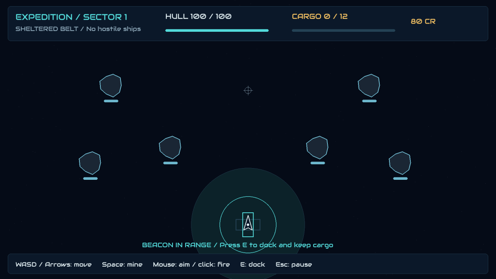

# Local campaign review — 2026-11-20

## 1. Scope and result

Local continuation of upstream `68e5e621b2bd8033b5e33aeb7e86eb84d67e0916`
on `feature/complete-small-game`. Adds a finite offline campaign: three mining
sectors, trading, upgrades, rival combat, two crew hires, passive support ships,
recoverable defeat, versioned station saves and a visible victory goal.
Dependencies and existing user settings are unchanged. Nothing is pushed upstream.

## 2. Ship visuals and controls

Choose **New Game → Launch / Sector 1**. Your white outline ship begins at the
blue station beacon, near the bottom centre. Rival ships are red in sectors 2/3.
Support ships grant sale bonuses and are not separately rendered. There is no
ship gallery or included ship sprite set; the standalone ship editor requires
an existing PNG/JPEG and creates attachment metadata, not artwork.

Screenshots were rendered from the actual screen classes with real bundled
fonts. They establish layout, not a manually played native-window session.

## 3. Validation

- Full pytest suite: **1,711 passed in 35.77 seconds**.
- Model tests exercise reachable movement, mining, collection, docking, sales,
  upgrades, combat rewards, defeat, progression and victory.
- A complete campaign simulation reached victory through 16 safe expeditions
  with 1,308 credits, three ships and both crew. Its 339.86 seconds of simulated
  world time excludes station interaction and is not a human playtime estimate.
- Save tests cover strict versioned parsing, finite/bounded state, duplicate
  keys, corrupted data, backup preservation and atomic write failures.
- UI/integration tests cover pause/focus loss, modal actions, checkpoint use,
  title transitions and app-owned QUIT/F11 events during transitions.
- Config regression coverage verifies historical `_help` metadata can coexist
  with actual settings and survives updates; the user's file was not rewritten.
- English/German station, flight, pause and victory screens were rendered and
  inspected at 1280×720. No additional dependencies or generated artwork.
- `zsh -n 'Open Dust to Dominion.command'` and `git diff --check` passed.
- Native windowed startup loaded the resources and exited with code 0. UI
  automation could not attach to the unbundled Python app; a complete native
  playthrough, audible behavior and Mac fullscreen remain unverified.

## 4. Independent review and corrections

Separate model, screen and persistence reviewers exercised the implementation.
Corrections include preserving QUIT/F11 during screen transitions and pausing
when focus loss arrives in the same batch as Resume or Launch. Input is cleared
on pause/resume. Save errors remain visible without stopping the live session.

## 5. Acceptance still needed

Spec 19 remains proposed pending human native-window play acceptance and balance
review. The game has a tested reachable ending; this does not certify that its
initial difficulty, pacing or simple vector graphics meet the player's taste.
Higher-resolution/fullscreen visual acceptance is also open. Historical local
macOS fullscreen patches referenced in older Vault notes were not present in
this checkout and have not been silently reconstructed.

The archive's pre-existing untracked first-playable documents are preserved.
`master` remains at upstream; all new work is on the local feature branch.
