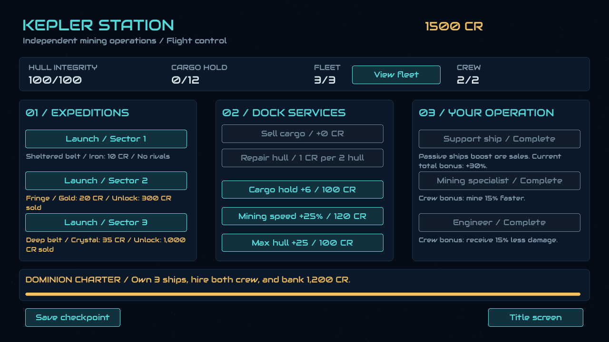
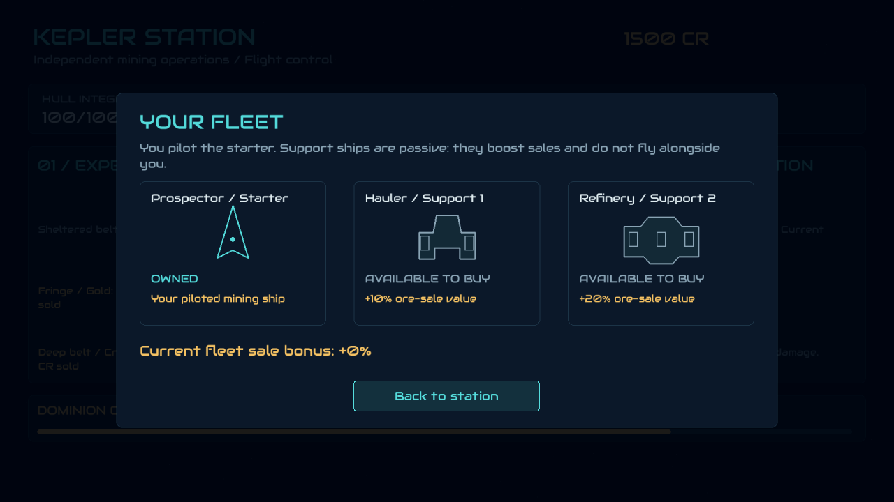
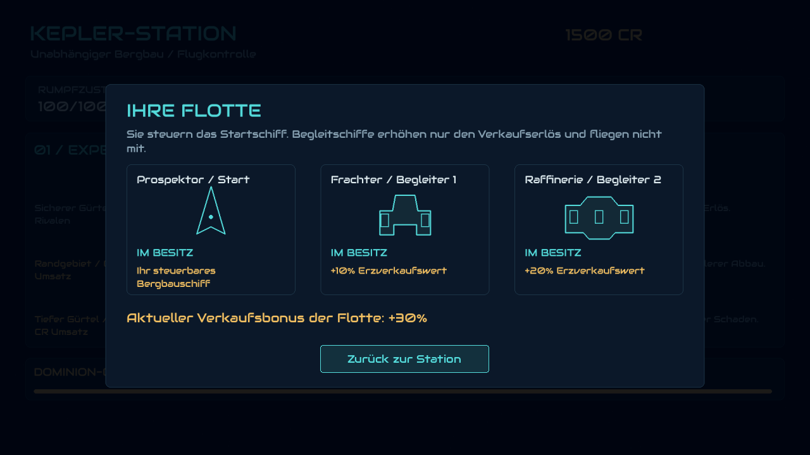

# Local campaign review — 2026-11-20

## 1. Scope and result

Local continuation of upstream `68e5e621b2bd8033b5e33aeb7e86eb84d67e0916`
on `feature/complete-small-game`. Adds a finite offline campaign: three mining
sectors, trading, upgrades, rival combat, two crew hires, passive support ships,
recoverable defeat, versioned station saves and a visible victory goal.
Dependencies and existing user settings are unchanged. Nothing is pushed upstream.

## 2. Ship visuals and controls

Choose **New Game → Launch / Sector 1**. Your white outline ship begins at the
blue station beacon, near the bottom centre. Rival ships are red in sectors 2/3.
Support ships grant sale bonuses and have distinct silhouettes in the new
station **View fleet** roster; they are not rendered as flying escorts. There
is no included ship sprite set; the standalone ship editor requires
an existing PNG/JPEG and creates attachment metadata, not artwork.

Screenshots were rendered from the actual screen classes with real bundled
fonts. They establish layout, not a manually played native-window session.

## 3. Validation

- Full pytest suite: **1,711 passed in 35.77 seconds**.
- Model tests exercise reachable movement, mining, collection, docking, sales,
  upgrades, combat rewards, defeat, progression and victory.
- A complete campaign simulation reached victory through 16 safe expeditions
  with 1,308 credits, three ships and both crew. Its 339.86 seconds of simulated
  world time excludes station interaction and is not a human playtime estimate.
- Save tests cover strict versioned parsing, finite/bounded state, duplicate
  keys, corrupted data, backup preservation and atomic write failures.
- UI/integration tests cover pause/focus loss, modal actions, checkpoint use,
  title transitions and app-owned QUIT/F11 events during transitions.
- Config regression coverage verifies historical `_help` metadata can coexist
  with actual settings and survives updates; the user's file was not rewritten.
- English/German station, flight, pause and victory screens were rendered and
  inspected at 1280×720. No additional dependencies or generated artwork.
- `zsh -n 'Open Dust to Dominion.command'` and `git diff --check` passed.
- Native windowed startup loaded the resources and exited with code 0. UI
  automation could not attach to the unbundled Python app; a complete native
  playthrough, audible behavior and Mac fullscreen remain unverified.

## 4. Independent review and corrections

Separate model, screen and persistence reviewers exercised the implementation.
Corrections include preserving QUIT/F11 during screen transitions and pausing
when focus loss arrives in the same batch as Resume or Launch. Input is cleared
on pause/resume. Save errors remain visible without stopping the live session.

## 5. Acceptance still needed

Spec 19 remains proposed pending human native-window play acceptance and balance
review. The game has a tested reachable ending; this does not certify that its
initial difficulty, pacing or simple vector graphics meet the player's taste.
Higher-resolution/fullscreen visual acceptance is also open. Historical local
macOS fullscreen patches referenced in older Vault notes were not present in
this checkout and have not been silently reconstructed.

The archive's pre-existing untracked first-playable documents are preserved.
`master` remains at upstream; all new work is on the local feature branch.

## 6. Continued validation and fixes

The second pass validated player input through the actual pygame event and
button contracts, rather than relying only on model commands. It covers New
Game, movement, mining/pickups, docking, selling, purchasing, saving, returning
to title, Continue, closing mid-expedition, and reaching/retaining victory.
An earned dangerous-sector unlock also exercises mouse aiming/fire and a
single docking bounty without injected credits, cargo, position or unlocks.
These are dummy-SDL integration tests, not native desktop automation.

A reachable balance exploit was reproduced: firing from station safety could
kill inactive rivals, allowing risk-free repeat bounty farming. Weapons now
lock inside the safe region, the shield absorbs friendly and hostile shots
(including grazing segments), and player range is limited to 585 units, within
rival detection. Regressions cover the original exploit and normal combat.

The new Fleet view shows three distinct vessel silhouettes, ownership, each
support benefit, and the current total ore-sale bonus. It is read-only; Esc
or Back returns to the station. Continue now distinguishes a missing checkpoint
from a damaged checkpoint, and replacement buttons use consistent typography.

Validation results for this revision:

- Final full suite: **1,730 passed in 35.40 seconds**.
- Independent reviewer gate: **120 focused tests passed**; no blockers found.
- Five event-driven acceptance cases include complete victory and earned combat.
- Real-font visual/click checks: English/German at 1280×720, 1920×1080 and
  2560×1440, including roster ownership states, missing-save/confirmation and
  station safety text. [Visual check records](fleet-visual-validation.json).
- Reproducible model probe: 120 expeditions, 93,891 updates, 40 defeats,
  34 docks and 46 forced abandons; bounds, finite values, ore conservation,
  projectile limits and checkpoint round-trips held. Safe victory took 16
  expeditions; the optimized dangerous-sector route took 6. These timings
  exclude human decisions and do not measure human difficulty.
- [Probe results](campaign-validation.json) and [probe source](validate_campaign.py).
  Reproduce from the project directory with
  `.venv/bin/python docs/reviews/validate_campaign.py`.
- Offscreen draw-cost sample (120 frames/view/resolution): station/flight
  95th-percentile rendering costs were 1.28–4.50 ms across the three sizes.
  This excludes presentation/audio and does not establish native frame rate.
- `git diff --check` passed. No dependency or saved-state-format changes.

Design validation boundary: no side-by-side comparison with a running reference
game has been performed. The engineering uses deterministic simulation,
collision geometry, bounded resources and transactional checkpoint replacement.
Movement is intentionally arcade-like, without spacecraft inertia/orbital
physics. Automated victory proves reachability, not fun, pacing or visual polish.
Native UI inspection remains blocked because the computer-use tool does not
recognize the running uv Python executable as an app; direct executable lookup
returned Invalid app. The existing running game was not interrupted.
