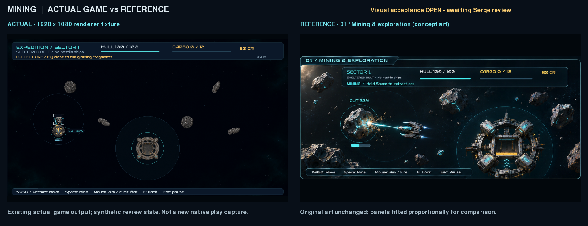
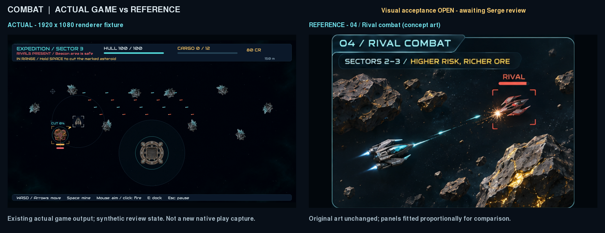
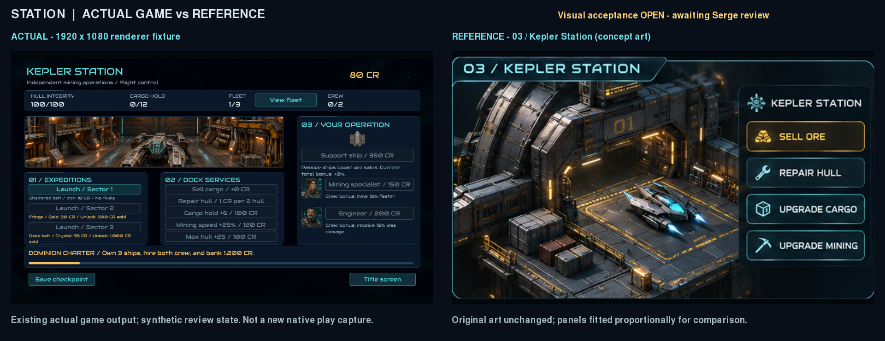
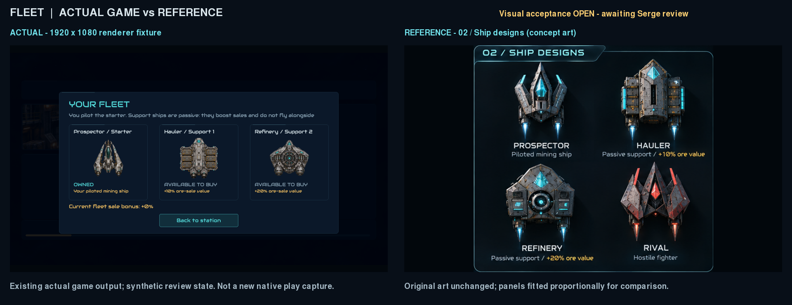

# Actual versus realistic reference — 2026-11-20

## 1. Review status and evidence

**Historical pre-camera review:** the authorized camera implementation and newer
images are recorded in the [camera report](../2026-11-20-camera/review.md).
The following observations and hash checks describe the earlier review checkpoint.

**Visual acceptance remains OPEN until Serge reviews the images.** This is an
assessment, not implementation approval. No gameplay, save, asset or rendering
code changed. The camera below is a recommendation, not a shipped feature.

[Comparison viewer](index.html) contains all four pairs and the analysis.
The PNG sheets below can be opened directly without a browser. Left is actual
game output; right is the corresponding panel from Serge's exact reference.
The sheets fit originals proportionally, without repainting them. They are review
layouts, not new game framebuffers.

The captures reviewed at that checkpoint are from product `957e96b`, with synthetic fixture
states drawn by the real SDL dummy renderer. All **36 recorded source hashes**
matched files at that checkpoint; the four original PNG hashes were also verified.
See [manifest](manifest.json) and the [prior validation report](../2026-11-20-realistic-polish.md).
These are not new native screenshots or proof of physical play. The native probe
and earned event-driven trip remain separate evidence in the prior report.

## 2. Actual screenshots beside the reference

### Mining / reference panel 01



The current small ships/rocks sit in a wide, mostly empty arena; the reference
fills its scene with substantial foreground rocks, station and mining contact.
CUT 33% and COLLECT coexist in the fixture because loose ore is already present.

### Combat / reference panel 04



This deliberately stressful fixture overlaps the rival with gold ore and arranges
projectiles synthetically. Red separation and the nearby health bar help, but the
rival remains a tiny mark. The reference separates ships and focuses on an impact.
The comparison does not imply that these exact projectile patterns occur in play.

### Station / reference panel 03



The detailed dock is squeezed into a shallow banner, cropping the foreground
ship. The reference gives most space to the bay, with a compact service menu.
The implemented station also exposes expedition, crew and progression controls;
matching the simpler reference layout requires reorganizing those controls while
preserving access, prices and behavior. Flight zoom will not change this menu.

### Fleet / reference panel 02



Fleet is the closest material/silhouette match. The reference has stronger cyan
engine light and brighter highlights against dark space. Its rival is a design
example, not a fourth purchasable fleet ship. Passive supports remain passive.

## 3. Three largest gaps and what closes them

| Category | Visible limitation | Required work |
| --- | --- | --- |
| Camera and framing | Distant full-arena view makes actors small; HUD/rings dominate. The dock image has too little height. | Evaluate a 1.5× follow camera with 1× overview and optional 2× close view, offscreen threat/station cues and edge clamps. Separately give the dock a taller composition and reorganize menu space. |
| Artwork | Iron looks pebble-like rather than fractured/veined; ships lack the reference's strong emission and material contrast. | Better ore silhouettes, fracture/material variants and authored emission layers; a dock image/composition suited to its panel. Retain useful existing fleet detail. Simply increasing pixel dimensions cannot add this content. |
| Rendering and feedback | Baked rotating light, restrained contact sparks/projectiles, thin rings and little depth. The 1080p canvas limits high-resolution detail. | Bounded mining-contact/depletion and rival hit/destruction effects, selective glow/light spill, subtle layered background motion, less dominant overlays, then direct output-resolution world drawing and performance checks. A full 3D rewrite is not required for these improvements. |

A 1.5–2× camera improves scale but does not fully reproduce the much tighter,
art-directed reference. Artwork improvements remain necessary after zoom.
A still image cannot establish animation quality or sound acceptance.

Weapons currently hit rivals, not asteroids. Space mines rocks. Rock breakup on
mining depletion could improve feedback without changing gameplay; making bullets
destroy rocks is a separate gameplay decision, not a rendering fix.

## 4. Camera evaluation — proposal only

Keep simulation/world coordinates, speeds, hitboxes, mining range, safe/docking
radii, AI distances and version-one saves unchanged. A presentation camera maps
world coordinates into a viewport below the HUD:

```text
view = viewport_center + zoom * (world - camera_center)
world = camera_center + (view - viewport_center) / zoom
```

Every world actor, projectile, beam endpoint, effect, range circle and annotation
anchor uses this transform. World radii scale by zoom. Place labels after the
transform in readable screen units, and clip world drawing to the viewport.
Menus/HUD text keep their existing proportional window scaling independently.
The current 64-unit player artwork slot becomes 96 logical pixels at 1.5× or
128 at 2×. Transform the scenery by the same factor; do not enlarge just ships.

Input must be converted into logical view coordinates once, then inverted through
the camera. `MainWindow._enter_fullscreen()` uses SDL `SCALED`, which already maps
mouse events to its 1920×1080 display surface. Do not apply physical fullscreen
scaling again. Windowed events use the existing surface-to-design conversion in
`ui.Scale.mouse()`. A future direct-output renderer must explicitly define its
window/logical/drawable-pixel relationship, including macOS scaling and letterboxes.

Keep cursor position in view space and recompute its world aim as the camera
moves, even if the mouse stays still. Preserve quick-click world targets at event
time and the existing pending-shot, focus and pause behavior. Culling, shield
circles and world annotation collision placement must all use the same camera.

At zoom z, visible world width/height are viewport width/height divided by z.
At 2×, visible area is one quarter of the same viewport at 1×. Enemies can still be
within attack range outside the view: add threat indicators/overview and test
visibility rather than changing AI ranges. Clamp camera edges to the world;
center/pad any axis whose visible extent exceeds the world bounds.

Render source sprites directly at their projected size. Magnifying the completed
1080p frame enlarges blur and HUD and does not implement a correct world camera.
Current sprite sources normalize to 512×512; higher-resolution originals are
retained. Revisit that cap only where projected size/detail warrants it, preserving
bounded transform caches.

### Required validation before implementation acceptance

- World→view→world round trips at each zoom, edge clamp and output size; pointer-to-target alignment across fullscreen/window changes.
- Stationary cursor during camera movement, quick clicks, held fire, pause/focus loss and HUD input boundaries.
- Mining/docking/safety boundaries, offscreen threats, actor/label clipping and readable annotation placement.
- Identical deterministic simulation outcomes and save bytes for identical world inputs; no gameplay geometry changes.
- Bounded caches and measured native performance, followed by physical mouse and visual review.

This review does not claim those camera tests passed; no camera exists yet.

## 5. Output versus internal rendering resolution

| Evidence | Output/window | Internal world | Limit |
| --- | --- | --- | --- |
| Four original captures shown | 1920×1080 PNG | 1920×1080 | Actual offscreen fixture rendering |
| Retained 4K PNGs | 3840×2160 PNG | 1920×1080 then scaled; text rasterized at output size | 4K output/layout, not native 4K world detail |
| Retained native Cocoa fullscreen probe | 3440×1440 desktop window | 1920×1080 backbuffer/world, scaled by SDL | Native monitor fullscreen, not physical 4K |
| Physical 3840×2160 fullscreen | Unverified | Not established | No acceptance evidence |

Sharper high-resolution world rendering requires an output-sized world target and
source-sprite drawing sized by zoom × output scale. Source-art detail is an
independent limit. Higher output resolution alone changes neither framing nor
materials. The comparison sheets themselves are 1920×740 layouts with resampled
previews; use the original PNG links in the viewer for pixel-level inspection.

## 6. Checks, warnings and remaining acceptance

This review verified current source/image hashes and visually inspected all four
comparison sheets. Links and image dimensions were checked. No product tests were
rerun because no product code changed. The previous 1,860-test pass is historical
evidence, not a new result. Its one known warning was `no fast renderer available`
under SDL dummy; the retained native probe log contained no warnings.

The browser tool rejected opening a local-file URL under its protocol policy.
No browser workaround was attempted. The PNG review sheets were generated and
inspected locally; browser rendering of the optional HTML viewer is unverified.

Visual acceptance, physical input/audio, human difficulty and physical native 4K
remain open. No camera, new effects, artwork replacements or station redesign
were implemented by this review.

Source pointers: [campaign drawing/input](../../../src/dtd/screens/campaign.py),
[sprite sources/caches](../../../src/dtd/campaign_sprites.py),
[fullscreen](../../../src/dtd/main_window.py), [input scale](../../../src/dtd/ui.py),
[unchanged model](../../../src/dtd/campaign.py).
